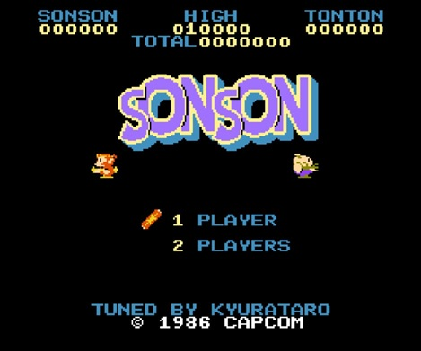
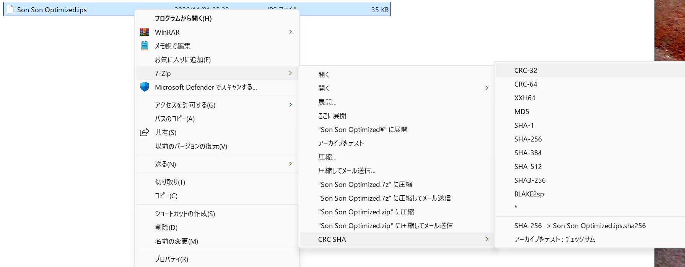

# ファミコン版ソンソン 最適化パッチ

## はじめに

ファミコン版 ソンソンの遅延解消したIPSパッチです。



TUNED BY KYURATARO と表示されているのはゲームデータに Q の文字がないため KY で代用しています。

もしよろしければ、プレイした感想を X(旧Twitter) で @qurataro 宛てにメンションつけて教えてくれると嬉しいです。

## IPSパッチの適用方法

セーブエディタ.com さんで IPS パッチの適用ツールが提供されてます。

https://web.save-editor.com/tool/rom_patcher_for_ips.html

特にPC上にツールやアプリを用意することなく適用させることができます。

## データの確認

データが一致しないことで、パッチ適用後にキャラクターや背景かちらついたり、ピカピカ光る不具合が報告されています。

パッチ適用後に挙動がおかしい場合は、一度ハッシュタグを確認してデータが正しいか確認しましょう。

### ハッシュタグ

|                   | CRC32    | SHA256                                                       |
| ----------------- | -------- | ------------------------------------------------------------ |
| オリジナルROM     | 6AD03AB3 | ceb0afd2af8274b46d7c4266927923391035336d59d2bf0b447c0854b87b1c92 |
| IPSパッチデータ   | C5EF9E72 | cbf3d6b099b437bbdbf6b5d449d351f73ffd5fa3a9cc0f538d9c9c87b13ce702 |
| パッチ適用後のROM | CAE01A54 | 9fc1dc4eb37644c25b26e237e9a388131050bbf3b02ee265ac341a87907103b2 |

### CRC32

7zip についてるタグ確認機能




### SHA256

Windows に標準でついているハッシュタグコマンドを使って、SHA256のハッシュタグを確認します。

```
certutil -hashfile "ファイル名" SHA256
```

## ファミコン版ソンソンの遅延の原因

ファミコン版ソンソンのもっさりした動きの原因が、サウンドの空スロット探し処理が原因であることを特定しました。

### サウンドの空スロット探し処理とは

32個の音データを0～31番の順番で優先番号が振られています。音を鳴らす処理が走ると、以下の処理が実行されます。

1. 音データを0～31番を順番にチェック
2. 9個の音のスロットを順番にチェックし、空いてれば実行、塞がってれば次のスロットで実行を繰り返す。

1の処理と２の処理は２重ループ処理であるため、運が悪いと最大288回(32 × 9)の処理が１フレームの処理で発生する。

### 改修

音の優先度チェックを廃止し、鳴らそうとする音を9個のスロットから順番にチェックし、空いてれば実行、塞がってれば次のスロットで実行という形にすることで、１フレーム最大9回の処理に変更した。

#### 改修後の弊害

この改修を行ったことで処理は劇的に早くなったが１つ問題が発生した。

音の優先度のチェックを行わないことで、一度再生した音がスロットを塞いでしまい、砦の曲（ボスの曲）が再生されると、９スロットすべて埋まってしまった。その結果、それ以降に発生する効果音、1upファンファーレ、死亡時の曲がならない不具合が発生した。

#### 対応

このゲームは、通常のBGMと砦の曲（ボスの曲）が交互に流れるという仕様に着目し、この曲が切り替わるタイミングで0～8スロットを全部リセットする処理を入れた。こうすることで、９スロットすべて埋まることがなくなり、音がならなくなる不具合が解消された。

スロットのリセット処理は本来不要だが、曲の優先度をチェックしなくなったので、逆に新たに必要になった処理である。

## その他チューニング

この処理を施したことで、体感的に処理が早くなったかどうかは不明ですが、ほかにも様々なチューニングを行っています。

### カウントアップループをカウントダウンループに変更

#### カウントアップループ

```
mov ecx, 0
.loop:
    ; ループ本体
    inc ecx             ; ecxを1増やす
    cmp ecx, N          ; 上限と比較（別命令が必要）
    jl .loop            ; または jne など
```

#### カウントダウンループ

```
mov ecx, N          ; ループ回数をセット
.loop:
    ; ループ本体
    dec ecx             ; ecxを1減らす（同時にZFフラグがセットされる）
    jnz .loop           ; ZFが0でなければ（つまりecx≠0なら）ループ
```

カウントアップルールは、以下の２つの処理が実行されます。

1. 現在の数値が指定した値と一致しているか
2. ループ処理を抜け出す値になっているか

しかしカウントダウン処理に変えると、以下の1つの処理しか実行されません。

1. ループ処理を抜け出す値になっているか

値の比較は処理であるため、回数が少ない方が処理が少なくなり結果的に処理が早くなります。

### 画面の外や画面内の遠い敵の処理を２フレームに１回にする

#### 通常の処理

通常はゲーム内の敵キャラの動きを、１フレーム１回処理し、動きをアニメーションのように滑らかに処理します。しかし、画面の外や画面内の遠い敵の処理まで１フレーム１回処理することはゲームの処理のリソースを考えるとやや無駄と判断しました。

#### 画面の外の敵

画面の中に納まっていないので、そもそも描画されません。しかし、画面の外から中に入ってくる演出のために、現在の座標位置を変更する処理は行う必要があります。そのため、描画を間隔を間引いてもプレイヤー及びゲーム画面を見ている人には何の影響も発生しません。

#### 画面内の遠い敵の処理

##### 人間の視覚特性

自分の操作するキャラクターの近くの敵は凝視しますが、遠くのキャラは「あそこにいるな」程度しか見ません。そのため、微妙に動きが粗くなってもほとんど気になりません。

##### 平均速度を保つことが重要

「1フレーム分の移動を2フレームに1回する」のではなく、「2フレーム分の移動量をまとめて適用する」ことで、全体の軌跡や平均速度はほぼ同じに保たれます。結果として動きの印象が大きく崩れません。

##### 優先度が低い

近くの敵は攻撃が当たる可能性があるため、動きもシビアである必要があります。しかし、遠くの敵は攻撃が当たらないので、多少動きが粗くても容認されやすい。

#### 近くの敵を２フレームに１回にしない理由

##### 動きが明らかなカクカクになる

近くの敵はどうしても凝視してしまうため、動きがカクカクで不自然な動きに見える場合があります。また、これによってゲーム本来の瞬時に反応する爽快感などが失われる可能性があります。

##### 当たり判定の精度が落ちる

近くの敵は、こちらの攻撃が当たるかどうかが重要です。その当たり判定の精度が落ちてしまうため、本来は命中しているのに、弾がすり抜けてしまって敵が消滅しないなどの不具合が発生します。
